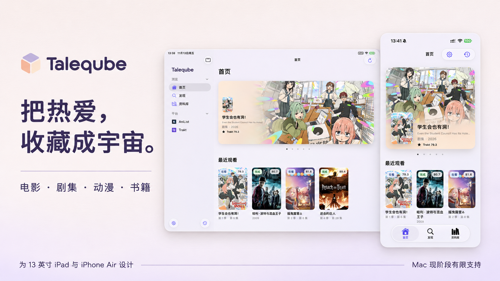
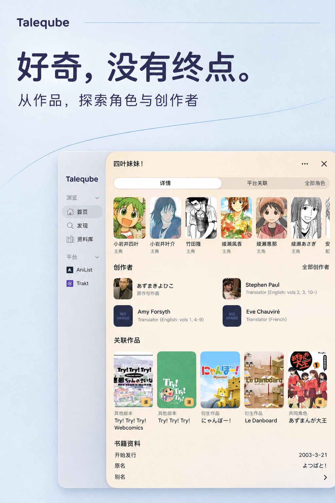
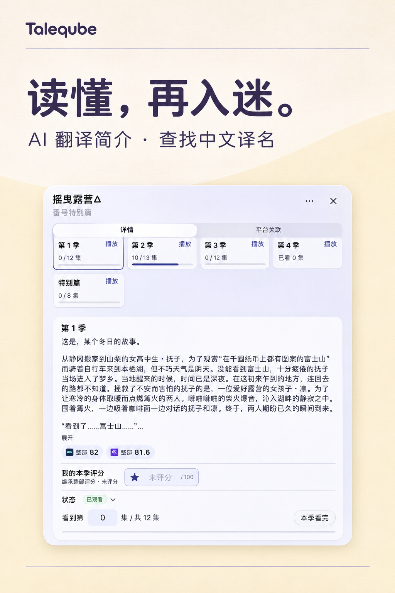
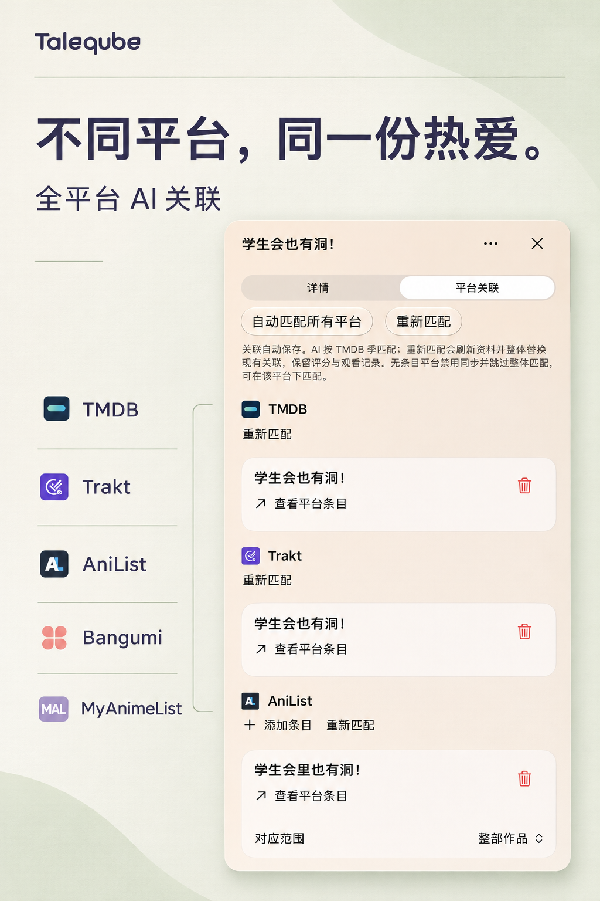
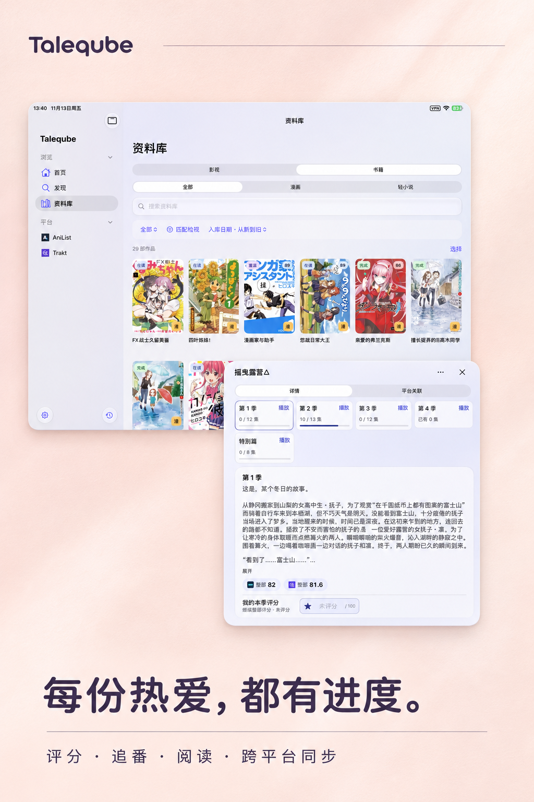
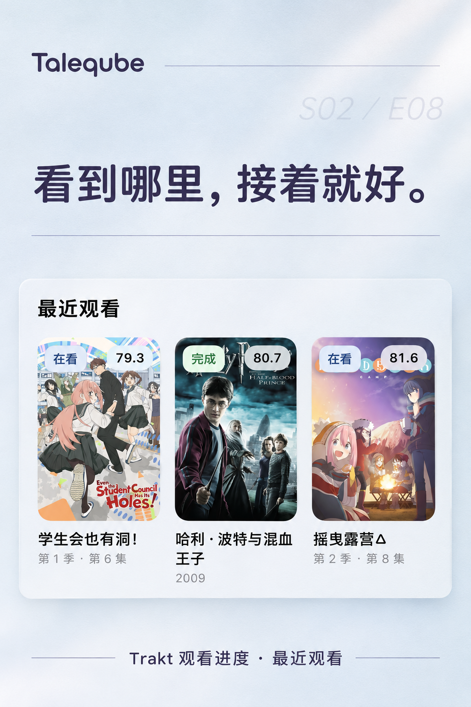
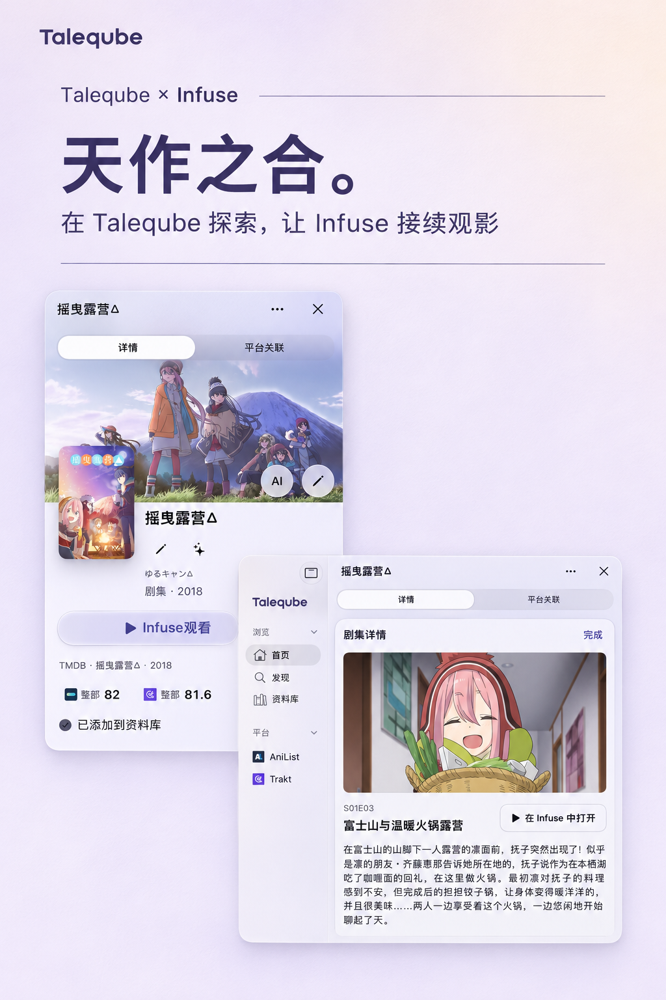
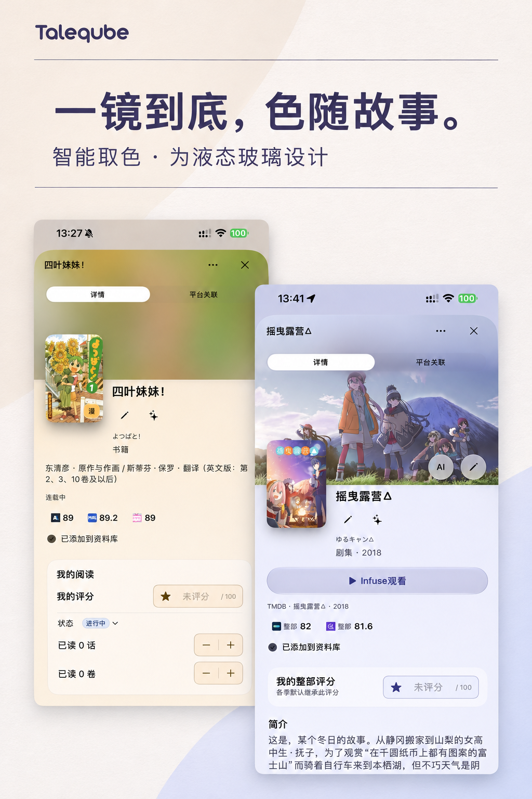

# Taleqube

### 把热爱，收藏成宇宙。

电影、剧集、动漫、漫画与轻小说，一处探索，一份记录。

[下载 IPA](https://github.com/Duke486/Taleqube/releases/latest) · [使用指南](https://github.com/Duke486/Taleqube/wiki) · [交流与反馈](https://github.com/Duke486/Taleqube/issues)

喜欢的作品散落在不同平台，译名各不相同，分季方式也不一样。想认真记下看过什么，又不想反复维护几份片单。

Taleqube 为喜欢电影、追番追剧、阅读漫画与轻小说的你，把探索、收藏、评分和进度放进同一个原生应用。尤其适合同时使用多个记录平台，以及希望与 Infuse 媒体库衔接的用户。

## 探索、记录与连接

<table>
<tr>
<td width="50%" valign="top">

<h3>随意一点，深入一点</h3>

从首页推荐出发，按年份、题材、地区与评分发现新作品。打开喜欢的作品，继续浏览角色、创作者、相关作品、季集资料与剧照；让下一次发现自然接上这一次好奇。资料库网格支持双指缩放，找到适合自己的浏览密度。

</td>
<td width="50%" valign="top">

<h3>好故事，不止一种语言</h3>

AI 翻译简介，查找中文译名与别名，让外语资料也能轻松阅读。原文与译文随时切换，喜欢的名字可以亲手修改；保存的译文留在本机，下次打开继续读。

</td>
</tr>
<tr>
<td width="50%" valign="top">

<h3>不同平台，同一份热爱</h3>

连接 <strong>TMDB、Trakt、AniList、Bangumi 与 MyAnimeList</strong>。让 AI 帮你查找同一部作品，进一步处理平台之间的拆季、跨季和集数差异。匹配会按需要读取详情、查找资料并多轮补证，也保留手动确认与修正入口。

影视以 TMDB 为统一坐标，书籍以 AniList 为主条目。各平台的资料、评分和链接汇聚到详情页，少一次来回搜索，多一点沉浸探索。

</td>
<td width="50%" valign="top">

<h3>评分与进度，一起同行</h3>

记录整部作品与季级评分，管理观看、重温与阅读进度。保存后，按已启用的关联同步到对应平台。不同平台的分季和内容范围通过映射衔接，评分与进度分别处理，失败任务可在同步记录中查看和重试。

通过 S3 加密云同步，在设备间延续资料库、关联与个人记录；也可以导出带密码的完整 <code>.taleqube</code> 备份。

</td>
</tr>
<tr>
<td width="50%" valign="top">

<h3>看到哪里，接着就好</h3>

接入 Trakt，获取观看历史与进度，在首页回到最近观看的作品。独立的 Trakt 与 AniList 片单入口，让平台收藏和本机资料库都触手可及。

</td>
<td width="50%" valign="top">

<h3>与 Infuse，天作之合</h3>

在 Taleqube 探索与记录，让 Infuse 接续观影。找到作品后，直接打开 Infuse 中对应的电影、季或剧集详情。入口贯穿作品与季集浏览，把发现、记录和个人媒体库连接起来。需安装 Infuse，并完成有效的 TMDB 匹配。

</td>
</tr>
</table>

## 一镜到底，色随故事

<table>
<tr>
<td width="50%">

</td>
<td width="50%" valign="middle">

从横图到背景、卡片与文字，智能取色让整页延续作品的气质。柔和的色阶、自然的深浅外观与原生缩放转场，让浏览保持连贯。

为液态玻璃设计。系统材质、悬浮导航与层次清晰的详情面板，带来属于 Apple 设备的轻盈手感。

</td>
</tr>
</table>

## 为你的设备设计

**专为 13 英寸 iPad、iPhone Air 设计并验证。iPad 建议横屏使用。** 其他设备遇到的问题，欢迎在 [Issues](https://github.com/Duke486/Taleqube/issues) 交流反馈。

**Mac 现阶段有限支持，未来将逐步完善至完整支持。**

当前系统要求为 iOS / iPadOS 27 或更高版本。GitHub Release 提供 IPA，安装前需使用自己的签名工具签名；平台账号与 AI 服务在应用内自行接入。[从这里开始配置](https://github.com/Duke486/Taleqube/wiki/Getting-Started)。

## 技术细节与开放源代码

原生 SwiftUI；SQLite 本地持久化；Keychain 凭据存储；S3 兼容云同步与 AES-GCM 加密资料库。平台 API 由设备直接访问，AI 请求发送到用户配置的服务。

使用 Xcode 27+ 打开 `Taleqube.xcodeproj`，设置自己的签名团队与 Bundle Identifier。[开发与验证](Docs/开发与验证.md) · [架构文档](Docs/README.md) · [功能详解](Docs/功能详解.md) · [欢迎 PR](CONTRIBUTING.md)

源代码采用 [Apache License 2.0](LICENSE)。修改与再分发须保留版权、许可及适用的 NOTICE 声明，并标明修改。Taleqube 名称与标识不授予商标使用权；截图中的作品图片、平台标识及资料归各自权利人所有。[第三方说明](THIRD_PARTY_NOTICES.md)
